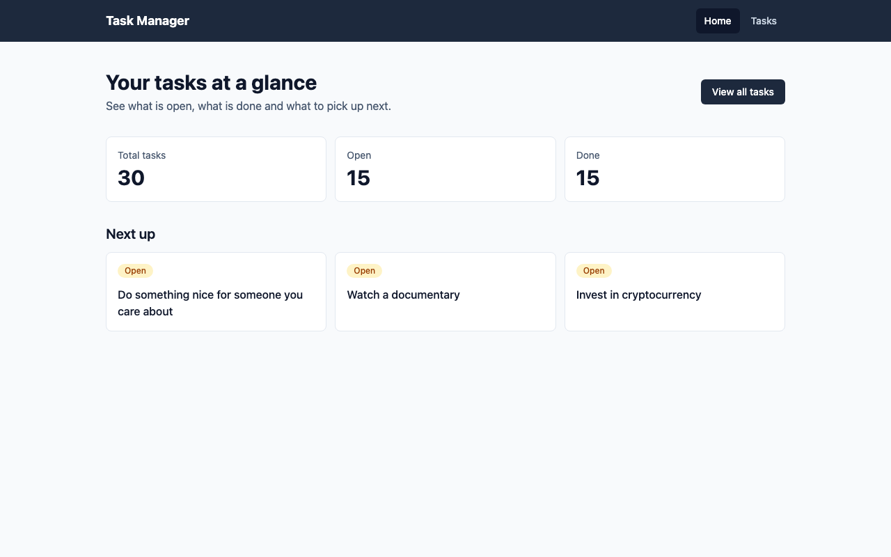
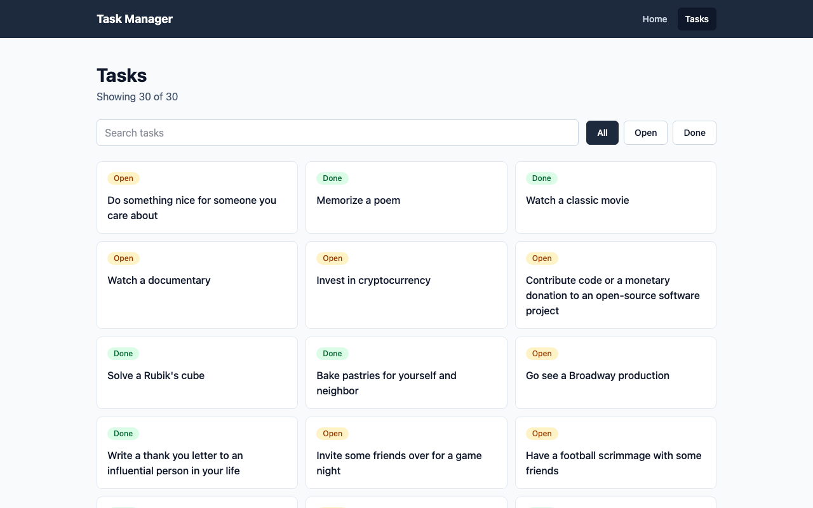
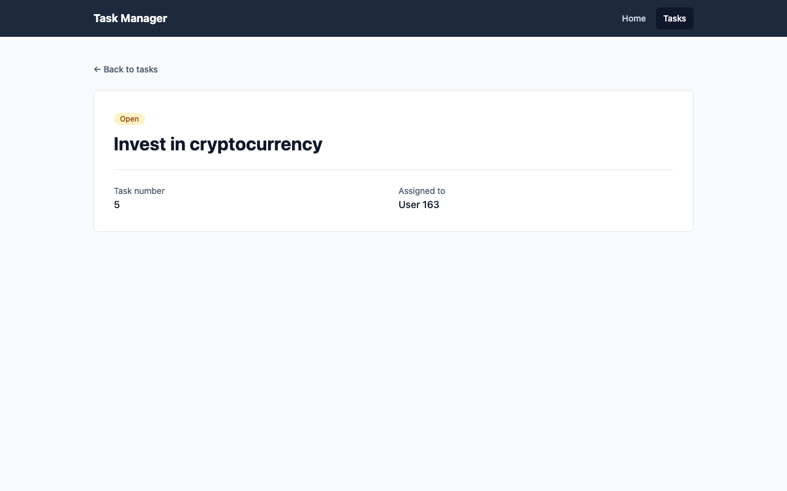
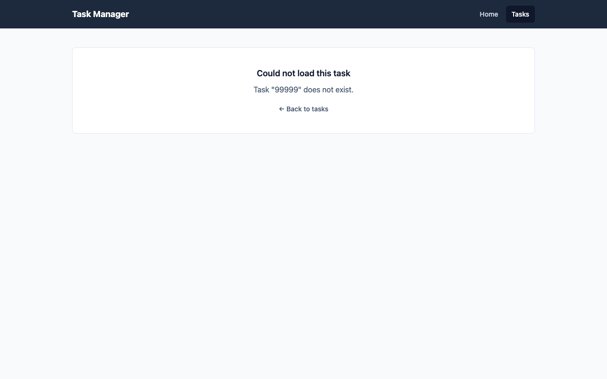
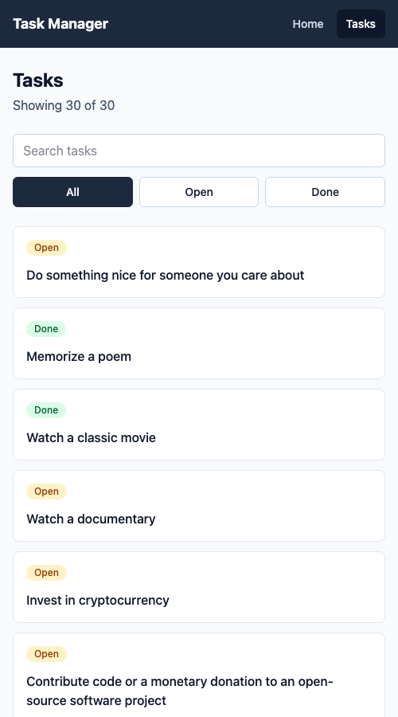

# Task Manager

A multi-page task and productivity manager built with React. It shows a summary of your tasks, lets you search and filter the full list, and opens any task on its own page.

## Features

### Routes

| Route | What it shows |
| --- | --- |
| `/` | Home: totals for all, open and done tasks, plus the next three open tasks |
| `/tasks` | Task list with a search box and an All / Open / Done filter |
| `/tasks/:taskId` | Task detail: reads `taskId` from the URL and shows the matching task |
| `*` | Not found page for any other address |

### Public API

Data comes from [DummyJSON](https://dummyjson.com/docs/todos):

- `GET https://dummyjson.com/todos` for the list
- `GET https://dummyjson.com/todos/:id` for a single task

### TanStack Query and UI states

All server data is fetched with `useQuery`, wrapped in two small hooks in `src/hooks/useTodos.js`:

- `useTodos()` uses the query key `['todos']`. The home page and the task list share it, so the list is fetched once and served from the cache.
- `useTodo(taskId)` uses the query key `['todos', taskId]`, so every task is cached separately.

Loading and error handling come from the query result (`isPending`, `isError`, `error`), not from hand-written state. `useState` is only used for the search text and status filter on the task list page.

| State | Where to see it |
| --- | --- |
| Loading | Open any page with network throttling switched on in the browser dev tools |
| Error | Visit `/tasks/99999`, a task that does not exist. The list page also shows an error with a "Try again" button if the request fails, for example when offline |
| Empty | On `/tasks`, search for text that matches nothing, such as `zzzz`. A "Clear filters" button resets the list |

### Screenshots

Home (`/`)



Task list (`/tasks`)



Task detail (`/tasks/5`)



Error state (`/tasks/99999`)



Task list on a narrow screen



## Setup

```bash
git clone https://github.com/engrjcbanares/task-manager.git
cd task-manager
npm install
npm run dev
```

Then open the address printed in the terminal, usually `http://localhost:5173`.

Other commands:

- `npm run lint` checks the code with ESLint
- `npm run build` creates a production build

## Tech stack

React, React Router, TanStack Query, Tailwind CSS, Vite.

## Live demo

https://task-manager-chi-inky-75.vercel.app
